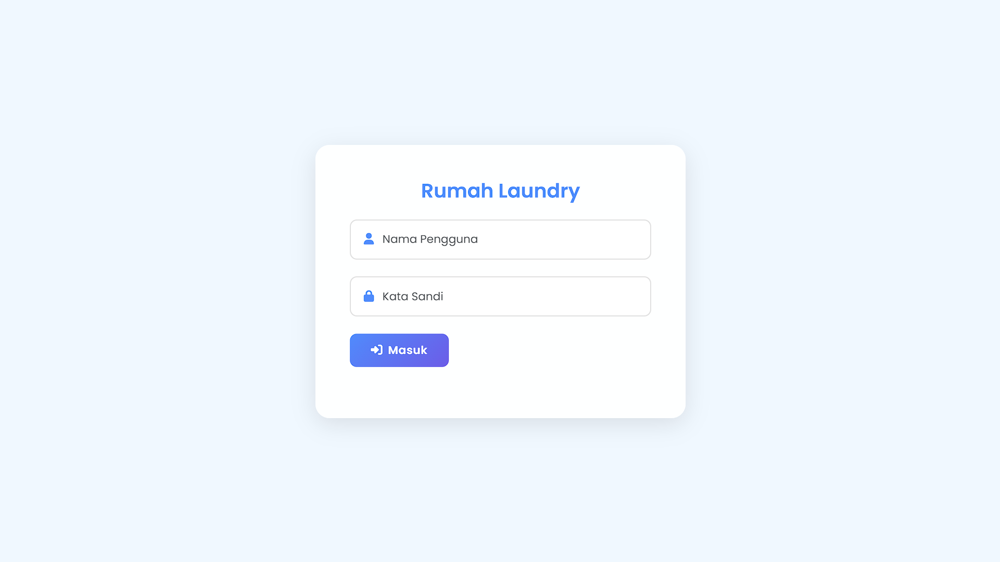
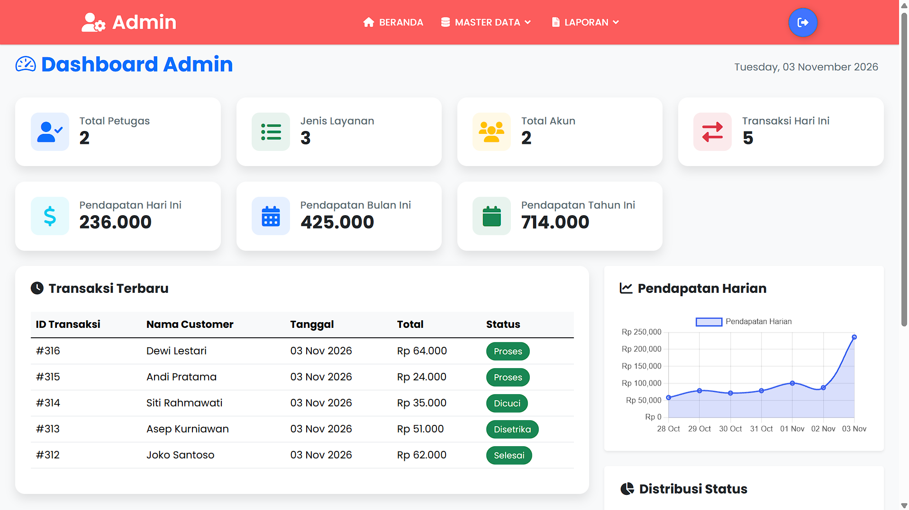
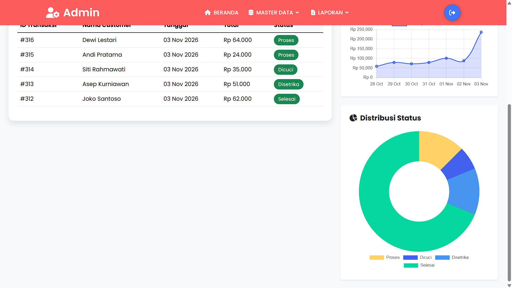
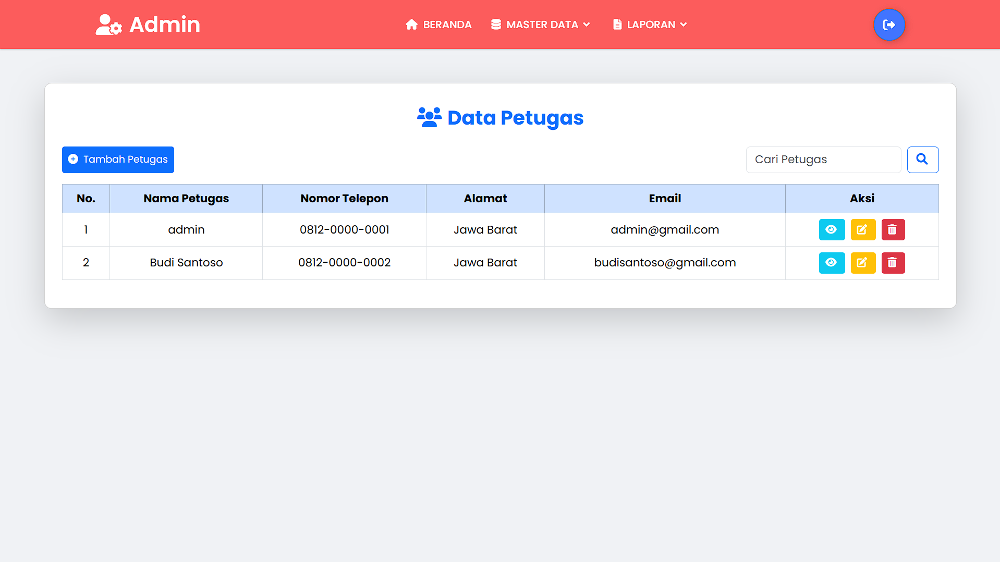
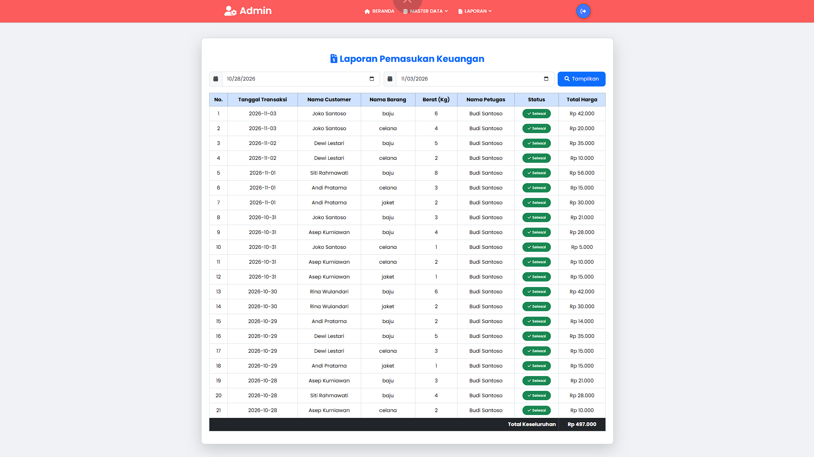
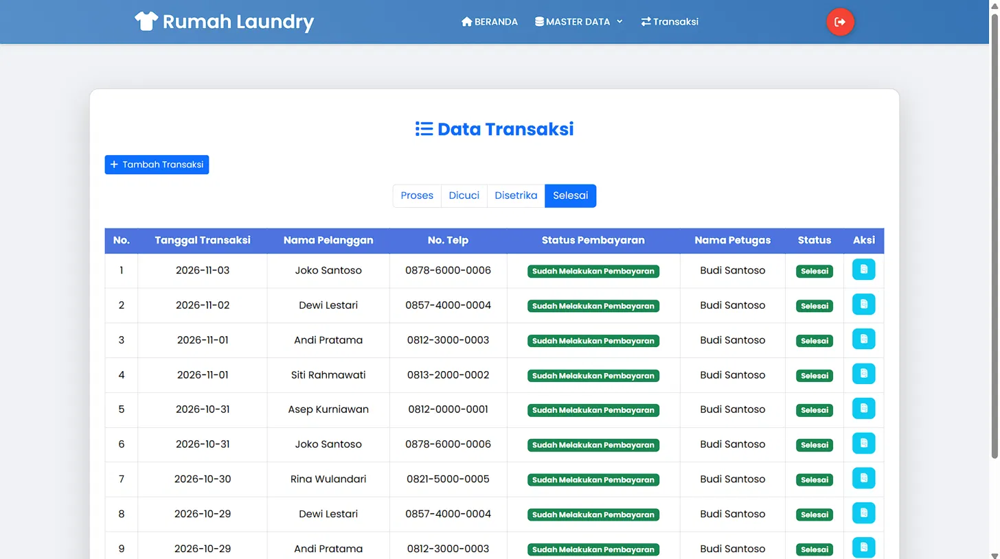
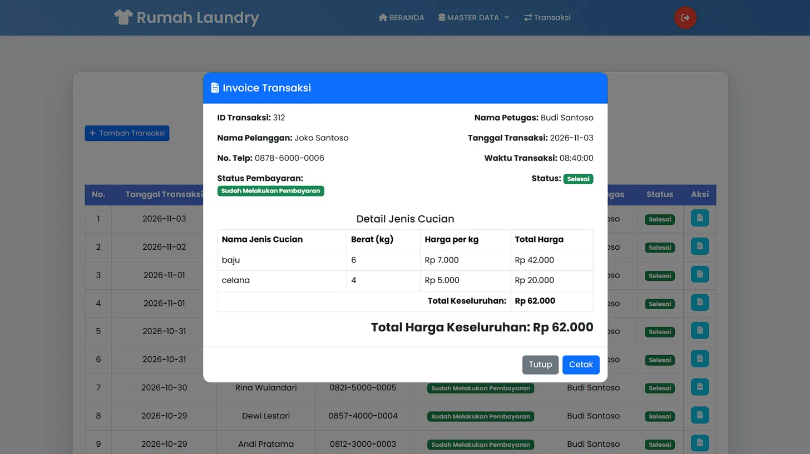
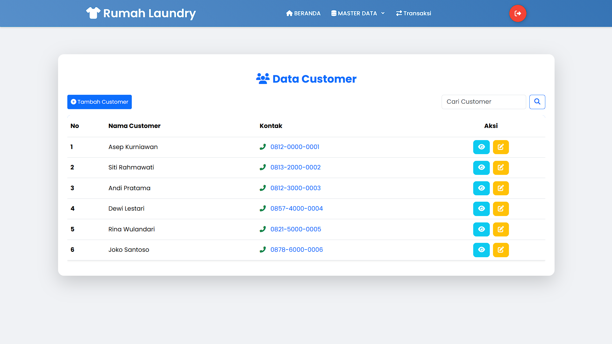

# Aplikasi Kasir Laundry

Aplikasi web untuk mengelola transaksi laundry, dibuat dengan PHP dan MySQL.
Ada dua level pengguna, yaitu admin dan petugas. [Tambahkan satu kalimat tentang
kenapa kamu membuatnya, misalnya tugas sekolah atau terinspirasi usaha laundry.]

## Fitur

**Admin**
- Dashboard berisi ringkasan pendapatan, grafik pendapatan harian, dan distribusi status cucian
- Kelola data petugas, jenis cucian, dan akun
- Laporan pemasukan keuangan dan laporan pekerjaan berdasarkan rentang tanggal

**Petugas**
- Tambah dan ubah data customer
- Buat transaksi, lalu ubah statusnya (Proses, Dicuci, Disetrika, Selesai)
- Cetak invoice transaksi

## Teknologi

- PHP (native) dan MySQL / MariaDB
- Bootstrap 5.3 dan Chart.js
- XAMPP sebagai server lokal

## Tampilan

## Cara Menjalankan

1. Pasang XAMPP, lalu nyalakan Apache dan MySQL.
2. Salin folder proyek ini ke `C:\xampp\htdocs\` dengan nama `laundry`.
3. Buka `http://localhost/phpmyadmin`, buat database baru bernama `laundry`.
4. Pilih database itu, klik tab Import, lalu pilih file `database/laundry.sql`.
5. Buka `http://localhost/laundry/admin/index.php` di browser.

## Akun Demo

| Level   | Username | Password |
|---------|----------|----------|
| Admin   | admin    | 1        |
| Petugas | Budi     | [isi password Budi] |

Semua data (nama, nomor telepon, transaksi) adalah data dummy.

## Yang Aku Pelajari

- [Tulis 2-3 hal dari proses membuat aplikasi ini dengan kata-katamu sendiri]
- Keamanan: awalnya aplikasi ini rawan SQL injection (login bisa dibobol
  dengan input seperti `admin'#`) dan password disimpan dengan MD5. Sekarang
  semua query yang memakai input pengguna memakai prepared statement,
  password disimpan dengan `password_hash()` dan dicek dengan
  `password_verify()`, dan hash password tidak lagi ditampilkan di halaman.
- Fitur hapus transaksi di halaman transaksi dihapus karena tidak punya
  tombol di tampilan. Kode yang tidak dipakai sebaiknya tidak ada.
- Yang masih perlu diperbaiki: proses hapus masih lewat link (GET), idealnya
  lewat form POST dengan token CSRF; pesan error database juga sebaiknya
  tidak ditampilkan ke pengguna.